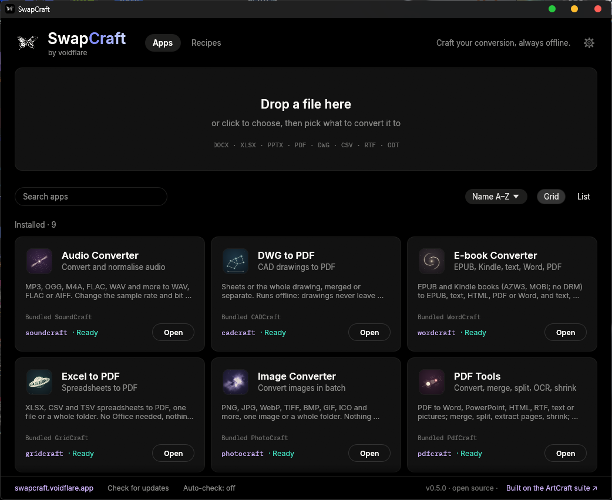

<p align="center">
  <a href="https://voidflare.app">
    
  </a>
</p>

<h3 align="center">Offline file converters for Windows. Drop a file, pick a format, done.</h3>

<p align="center">
  <a href="LICENSE-MIT"></a>
  <a href="https://github.com/Flaeren/voidflare/releases"></a>
  
  
  
  
  <a href="CREDITS.md"></a>
</p>

<p align="center">
  <a href="#quick-start">Quick start</a> ·
  <a href="#what-it-converts">What it converts</a> ·
  <a href="#how-it-works">How it works</a> ·
  <a href="#built-on-artcraft-credits-and-licences">Credits and licences</a> ·
  <a href="#build-from-source">Build</a> ·
  <a href="#contributing">Contributing</a> ·
  <a href="#licence">Licence</a>
</p>

<p align="center">
  <a href="https://voidflare.app"></a>
</p>

voidflare takes a file and offers the formats it can become. Your files never leave your PC, there is no account, and you need no Microsoft Office. It is a small hub plus nine apps, and you install only the ones you use: each app is a separate download, and it either comes with its own conversion engine or, if your PC already has a version of ArtCraft that we have tested, uses that one instead of downloading a second copy.

> **Status:** early (v0.3.0). The programs are not code-signed yet, so Windows SmartScreen may warn on first run (see Quick start).

## Built on ArtCraft: credits and licences

voidflare's conversions are done by command-line engines of the **[ArtCraft](https://getartcraft.com)** suite, written by its authors and used under their licences; the one exception is reading and writing EPUB and Kindle books, which is voidflare's own Rust code. This project is independent and not affiliated with or endorsed by the ArtCraft team.

| App | Engine | Engine licence |
|---|---|---|
| Word to PDF | WordCraft | MIT **or** Apache-2.0 |
| Excel to PDF | GridCraft | MIT **or** Apache-2.0 |
| Slides to PDF | DeckCraft | MIT **or** Apache-2.0 |
| PDF Tools | PdfCraft | MIT **or** Apache-2.0 |
| DWG to PDF | CADCraft, with one local fix ([patch](src/vendor/cadcraft-tilted-insert.patch)) | MIT **or** Apache-2.0 |
| Image Converter | PhotoCraft | MIT **or** Apache-2.0 |
| Audio Converter | SoundCraft | MIT **or** Apache-2.0 |
| Video Converter | FilmCraft | MIT **or** Apache-2.0 |
| E-book Converter | WordCraft for PDF and Word; reading EPUB and Kindle books and writing EPUB is voidflare's own code | MIT **or** Apache-2.0 |

- The release package keeps each engine's `LICENSE-MIT`, `LICENSE-APACHE`, `NOTICE` and `ATTRIBUTION` files next to it. They list the further components, fonts and models each engine bundles.
- The ArtCraft name, logo and trademarks are not covered by those licences and are not used here as ours.
- Full details, libraries and translation status: **[CREDITS.md](CREDITS.md)** and **[NOTICE](NOTICE)**.
- voidflare's own code: **[MIT](LICENSE-MIT) or [Apache-2.0](LICENSE-APACHE)**, at your option.

## Quick start

1. Download `voidflare-hub-<version>-windows.zip` from the [Releases](../../releases) page (about 7 MB).
2. Unzip it to a short path, for example `C:\voidflare`, and run `voidflare.exe`.
3. Press **Install** on the converters you need. Each card says what it will download before you click: the app (about 6 MB) plus its engine (5 to 50 MB), or only the app when your PC's ArtCraft engine is a version we have tested. Every download is checked against the release's `SHA256SUMS.txt` before it is installed.
4. Drop a file on the hub.

**No network where you work?** Download `voidflare-<version>-windows.zip` instead (about 210 MB): the hub and all nine apps with their engines in one file, nothing else to fetch.

The programs are not code-signed yet, so Windows SmartScreen may warn on first run: choose *More info*, then *Run anyway*. Or unblock the ZIP (right click, Properties, *Unblock*) before extracting.

You can also drop a file on `voidflare.exe` in Explorer, or send it there with *Open with*. Each app also runs on its own from `apps\<app>\`.

## What it converts

| App | Reads | Writes |
|---|---|---|
| Word to PDF | DOCX, DOC, RTF, ODT | PDF |
| Excel to PDF | XLSX, CSV, TSV | PDF |
| Slides to PDF | PPTX | PDF |
| PDF Tools | PDF | DOCX, PPTX, HTML, RTF, TXT, PNG, JPG; also merge, split, extract pages, shrink, OCR (English only) |
| DWG to PDF | DWG | PDF: sheets merged or separate, or the whole drawing on one page |
| Image Converter | PNG, JPG, WebP, TIFF, BMP, GIF, ICO, TGA, PSD, EXR, HDR, DDS, DPX, QOI | PNG, JPG, WebP, TIFF, BMP, GIF, ICO, TGA, PSD |
| Audio Converter | WAV, FLAC, AIFF, MP3, OGG, M4A, AAC, CAF and more | WAV, FLAC, AIFF (not MP3 or OGG) |
| Video Converter | MP4, MOV, MKV, WebM, AVI, MPEG, TS, MXF | MP4 (H.264), MOV (ProRes), GIF, or only the sound as WAV, M4A, FLAC |
| E-book Converter | EPUB, AZW3, AZW, MOBI, PRC (no DRM), TXT, HTML, Markdown, DOCX, ODT, RTF | EPUB, TXT, HTML, PDF, DOCX |

Books with DRM (copy protection) are refused: voidflare converts DRM-free books only and never tries to remove protection.

Available in English, Italiano, Español, Français and Deutsch.

## How it works

- **The hub** (`voidflare.exe`) has a drop panel. It looks at the file type, shows the formats that file can become, and runs the matching engine with default settings. The converted file lands next to the original.
- **The apps** have the full options: batches and folders, merging, page ranges, OCR, drawing sheets or the whole drawing.
- **The engines** are separate command-line programs. An app uses the copy in its own folder first, then a regular ArtCraft installation. When you install an app, voidflare reuses the ArtCraft engine already on your PC only if that exact version is listed in [`src/engine-compat.json`](src/engine-compat.json), meaning we ran it against the real engine; any other version, including a newer one nobody has tried, gets our own tested copy. If ArtCraft later updates to a version we have not tested, the card says so and offers *Bundle engine*. DWG to PDF always brings its own CADCraft, because the official build still draws blocks with a tilted extrusion wrongly ([cadcraft#1158](https://github.com/storytold/cadcraft/issues/1158)).
- **Nothing is sent anywhere.** Conversions run locally and there is no telemetry.
- **Updates.** When the hub starts it asks `github.com/Flaeren/voidflare` once for the latest release (one HTTPS request, no identifier, nothing about you). The *AUTO-CHECK* switch in the footer turns this off; the *CHECK FOR UPDATES* link does it on demand. The same request reads the release's list of apps. If there is a newer hub, *UPDATE NOW* downloads its small ZIP, checks its SHA-256 against the release's `SHA256SUMS.txt`, swaps it in place of the running hub (the old one is kept as `voidflare.old.exe` until the next start) and restarts it; if the new file does not check out, nothing changes. Only `voidflare.exe` is replaced: the apps you installed are left alone and update from their own cards (*Install*, *Update* and *Remove* install into `apps\` next to the hub, after the same checksum check). voidflare never downloads anything without a click.

## For AI assistants (MCP)

`voidflare-cli.exe`, next to the hub, is a [Model Context Protocol](https://modelcontextprotocol.io) server, so an assistant can use every converter without opening a window. Add it to your client, for example in Claude Code:

```
claude mcp add voidflare -- C:\voidflare\voidflare-cli.exe mcp --allow C:\Users\you\Documents
```

Or in any client's JSON configuration:

```json
{ "mcpServers": { "voidflare": { "command": "C:\\voidflare\\voidflare-cli.exe", "args": ["mcp", "--allow", "C:\\Users\\you\\Documents"] } } }
```

Tools: `voidflare_formats` (what converts to what), `voidflare_convert`, `voidflare_pdf_merge`, `voidflare_pdf_split`, `voidflare_pdf_extract`, `voidflare_pdf_ocr`, `voidflare_pdf_shrink`, `voidflare_info`, `voidflare_engines`. The server can only read and write inside the folder it was started in and each `--allow` folder you give it; `--allow-all` removes that limit. Nothing leaves your PC. The same engines are available from a terminal: `voidflare-cli formats`, `voidflare-cli convert book.epub --to pdf`.

## System requirements

- Windows 10 or 11, 64-bit.
- Disk space: about 20 MB for the hub, plus what you install (an app with its own engine is 30 to 110 MB; all nine with their engines are well over 1 GB, so install only what you need).
- No Visual C++ runtime and no Microsoft Office. An internet connection is needed only to install or update an app from the hub; the full ZIP needs none.

## Build from source

You need Windows, the Rust toolchain and an internet connection for the first build. The engines are not installed by hand: `fetch-engines.ps1` downloads the exact versions pinned in [`src/engines.json`](src/engines.json) from the official ArtCraft releases and refuses any file whose SHA-256 differs from the pinned one. CADCraft is built from source at a pinned commit with our patch.

```powershell
cd src
powershell -File fetch-engines.ps1 -BuildCadcraft   # engines, pinned and hash-checked (-BuildCadcraft needs git)
powershell -File build-apps.ps1                     # writes ..\portable\voidflare.exe and ..\portable\apps\<app>\
powershell -File release.ps1                        # packs portable\ into ..\release\: full bundle, hub, one ZIP per app and engine, manifest.json, SHA256SUMS.txt
cargo test --release -p vf-core                     # tests that need an engine skip themselves when it is missing
```

```
src/
  hub/            the launcher with the drop panel
  crates/
    vf-core/      engine discovery, jobs, PDF and DWG operations, translations
    vf-ui/        theme and shared widgets
    app-*/        one crate per app
  vendor/         the patch for CADCraft
  licenses/       licence texts copied next to each bundled engine
  engines.json    the engines bundled, pinned by version and SHA-256
  engine-compat.json  the ArtCraft engine versions we have tested, which an app may reuse from the PC
  fetch-engines.ps1  downloads and verifies them (and builds CADCraft with our patch)
  build-apps.ps1  builds everything into portable/
  release.ps1     packs portable/ into the release files (full bundle, hub, apps, engines, manifest.json, SHA256SUMS.txt)
site/             the website (voidflare.app)
docs/             images for this page
```

## Contributing

Bug reports, translation fixes and format requests are welcome. See [CONTRIBUTING.md](CONTRIBUTING.md). Security issues: see [SECURITY.md](SECURITY.md).

## Licence

voidflare is dual-licensed under [MIT](LICENSE-MIT) or [Apache-2.0](LICENSE-APACHE), at your option. The bundled engines have their own licences, shipped with them; see [Built on ArtCraft](#built-on-artcraft-credits-and-licences).

---

<p align="center"><sub>Made by Gabriele Denaro · <a href="https://github.com/Flaeren">GitHub: Flaeren</a> · <a href="https://gabrieledenaro.com">gabrieledenaro.com</a><br>Built on the <a href="https://getartcraft.com">ArtCraft</a> suite · Made with Rust</sub></p>
