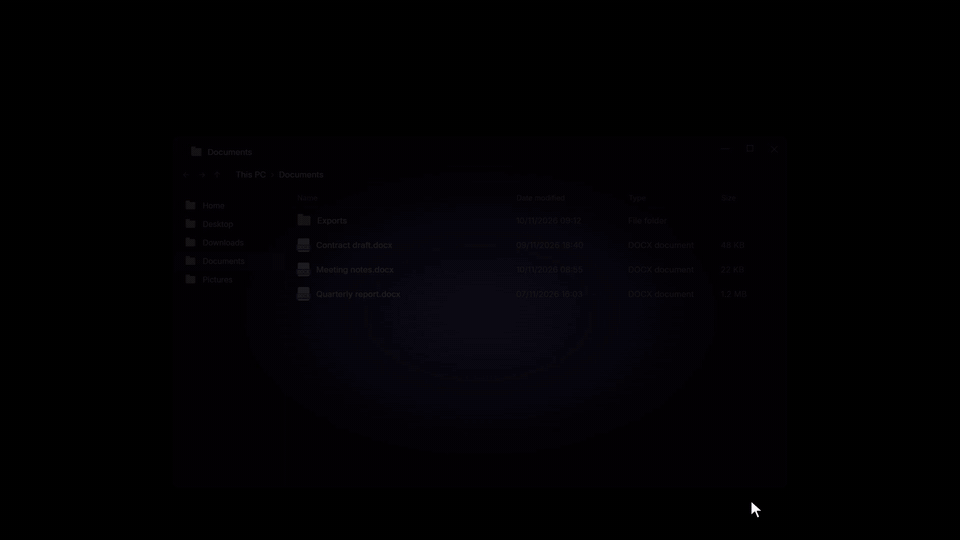
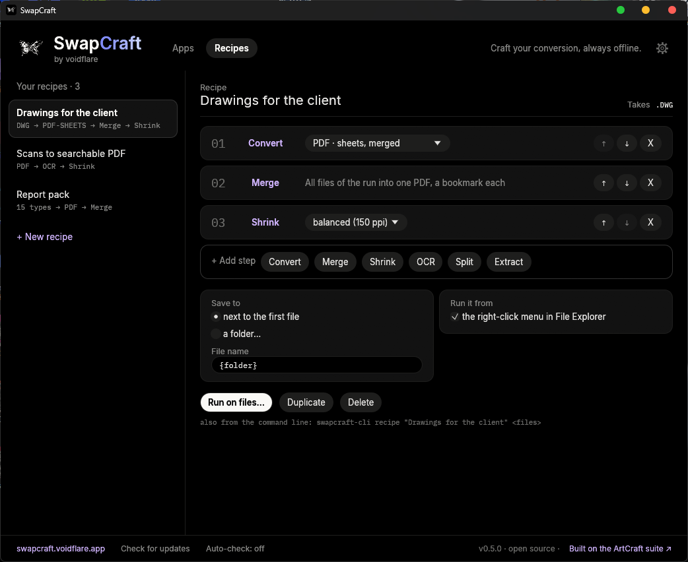

<p align="center">
  <a href="https://swapcraft.voidflare.app">
    
  </a>
</p>

<h3 align="center">Craft your conversion, always offline.</h3>

<p align="center"><b>Offline file converters for Windows and Linux: Office documents, PDF, DWG drawings, images, audio, video and e-books, converted on your own PC.</b><br>Drop a file, pick a format, done.</p>

<p align="center"><sub>This repository and <a href="https://swapcraft.voidflare.app">swapcraft.voidflare.app</a> are SwapCraft's only official homes.</sub></p>

<p align="center">
  <!-- The project -->
  <a href="https://github.com/Flaeren/swapcraft/releases/latest"></a>
  <a href="https://github.com/Flaeren/swapcraft/actions/workflows/build.yml"></a>
  
  
  <a href="LICENSE-MIT"></a>
  <br>
  <!-- What it promises -->
  
  
  <a href="CREDITS.md"></a>
</p>

<p align="center">
  <a href="#principles">Principles</a> ·
  <a href="#quick-start">Quick start</a> ·
  <a href="#what-it-converts">What it converts</a> ·
  <a href="#how-it-works">How it works</a> ·
  <a href="#built-on-artcraft-credits-and-licences">Credits and licences</a> ·
  <a href="#build-from-source">Build</a> ·
  <a href="#contributing">Contributing</a> ·
  <a href="#licence">Licence</a>
</p>

<p align="center">
  <a href="https://swapcraft.voidflare.app"></a>
</p>

**SwapCraft** (by voidflare) takes a file and offers the formats it can become. Your files never leave your PC, there is no account, and you need no Microsoft Office. It is a small hub plus nine apps, and you install only the ones you use: each app is a separate download, and it either comes with its own conversion engine or, if your PC already has a version of ArtCraft that we have tested, uses that one instead of downloading a second copy. It also works from where you already are: the right-click menu on a file, a right-button drag onto a folder, the command line, and AI assistants through MCP.

SwapCraft is built the way the [ArtCraft](https://getartcraft.com) apps are: in Rust, with the same egui interface the Craft launchers use, and on top of the suite's own command-line engines (WordCraft, GridCraft, DeckCraft, PdfCraft, CADCraft, PhotoCraft, SoundCraft and FilmCraft), which do the converting.

<p align="center">
  
</p>

**Recipes: several steps, one click.** Line up converting, merging, shrinking and OCR once. Then run it from the hub, from the right-click menu on a file, or by dragging files with the right mouse button onto a folder: a DWG becomes PDF sheets, merged and shrunk; scans become a searchable PDF; a mixed folder becomes one single PDF.

<p align="center">
  
</p>

> **Status:** early (v0.6.0). The programs are not code-signed yet, so Windows SmartScreen may warn on first run (see Quick start).

## Principles

- **Your files stay on your PC.** Every conversion runs locally. There is no account and no telemetry; the only request SwapCraft makes on its own is the update check, which you can turn off, and it never downloads anything without a click.
- **The engines belong to their authors.** Everything but EPUB and Kindle books is converted by an ArtCraft engine, used under its licence and shipped with its licence files. The one change we make, to CADCraft, is published as a [patch](src/vendor/cadcraft-tilted-insert.patch).
- **Only versions we have tried.** Each engine is pinned to an official release and checked by its SHA-256. An ArtCraft engine already on your PC is reused only if that exact version passed our engine test.
- **Every download is checked.** Apps, engines and hub updates are compared with the release's `SHA256SUMS.txt` before they are installed; if a file does not match, nothing changes.
- **Install only what you use.** The hub is a few megabytes; each converter is a separate download.

## Built on ArtCraft: credits and licences

SwapCraft's conversions are done by command-line engines of the **[ArtCraft](https://getartcraft.com)** suite, written by its authors and used under their licences; the one exception is reading and writing EPUB and Kindle books, which is SwapCraft's own Rust code. This project is independent and not affiliated with or endorsed by the ArtCraft team.

| App | Engine | Engine licence |
|---|---|---|
| Word to PDF | WordCraft | MIT **or** Apache-2.0 |
| Excel to PDF | GridCraft | MIT **or** Apache-2.0 |
| Slides to PDF | DeckCraft | MIT **or** Apache-2.0 |
| PDF Tools | PdfCraft | MIT **or** Apache-2.0 |
| DWG to PDF | CADCraft, with one local fix ([patch](src/vendor/cadcraft-tilted-insert.patch)) | MIT **or** Apache-2.0 |
| Image Converter | PhotoCraft | MIT **or** Apache-2.0 |
| Audio Converter | SoundCraft | MIT **or** Apache-2.0 |
| Video Converter | FilmCraft | MIT **or** Apache-2.0 |
| E-book Converter | WordCraft for PDF and Word; reading EPUB and Kindle books and writing EPUB is SwapCraft's own code | MIT **or** Apache-2.0 |

- The release package keeps each engine's `LICENSE-MIT`, `LICENSE-APACHE`, `NOTICE` and `ATTRIBUTION` files next to it. They list the further components, fonts and models each engine bundles.
- The ArtCraft name, logo and trademarks are not covered by those licences and are not used here as ours.
- Full details, libraries and translation status: **[CREDITS.md](CREDITS.md)** and **[NOTICE](NOTICE)**.
- SwapCraft's own code: **[MIT](LICENSE-MIT) or [Apache-2.0](LICENSE-APACHE)**, at your option.

## Quick start

1. Download `swapcraft-hub-<version>-windows.zip` from the [Releases](../../releases) page (about 7 MB).
2. Unzip it to a short path, for example `C:\SwapCraft`, and run `SwapCraft.exe`.
3. Press **Install** on the converters you need. Each card says what it will download before you click: the app (about 6 MB) plus its engine (5 to 50 MB), or only the app when your PC's ArtCraft engine is a version we have tested. Every download is checked against the release's `SHA256SUMS.txt` before it is installed.
4. Drop a file on the hub.

**No network where you work?** Download `swapcraft-<version>-windows.zip` instead (about 210 MB): the hub and all nine apps with their engines in one file, nothing else to fetch.

The programs are not code-signed yet, so Windows SmartScreen may warn on first run: choose *More info*, then *Run anyway*. Or unblock the ZIP (right click, Properties, *Unblock*) before extracting.

You can also drop a file on `SwapCraft.exe` in Explorer, or send it there with *Open with*. Each app also runs on its own from `apps\<app>\`.

### On Linux

1. Download `swapcraft-hub-<version>-linux-x86_64.zip` from the [Releases](../../releases) page, or `swapcraft-<version>-linux-x86_64.zip` for everything in one file.
2. Unzip it to a folder of your own, for example `~/SwapCraft`, and run `swapcraft` (double click it, or `./swapcraft` in a terminal).
3. Install the converters you need from their cards, as on Windows. In Settings you can add SwapCraft to your applications menu and to the desktop.

Settings and recipes are kept in `~/.config/voidflare`. The right-click menu and *Convert here* when dragging with the right mouse button are Windows File Explorer features and are not on Linux yet. The Linux programs are built on Ubuntu 22.04, so they need a system at least that recent (Linux Mint 21 or newer, for example), 64-bit x86.

## What it converts

| App | Reads | Writes |
|---|---|---|
| Word to PDF | DOCX, DOC, RTF, ODT | PDF |
| Excel to PDF | XLSX, CSV, TSV | PDF |
| Slides to PDF | PPTX | PDF |
| PDF Tools | PDF | DOCX, PPTX, HTML, RTF, TXT, PNG, JPG; also merge, split, extract pages, shrink, OCR (English only) |
| DWG to PDF | DWG | PDF: sheets merged or separate, or the whole drawing on one page |
| Image Converter | PNG, JPG, WebP, TIFF, BMP, GIF, ICO, TGA, PSD, EXR, HDR, DDS, DPX, QOI | PNG, JPG, WebP, TIFF, BMP, GIF, ICO, TGA, PSD |
| Audio Converter | WAV, FLAC, AIFF, MP3, OGG, M4A, AAC, CAF and more | WAV, FLAC, AIFF (not MP3 or OGG) |
| Video Converter | MP4, MOV, MKV, WebM, AVI, MPEG, TS, MXF | MP4 (H.264), MOV (ProRes), GIF, or only the sound as WAV, M4A, FLAC |
| E-book Converter | EPUB, AZW3, AZW, MOBI, PRC (no DRM), TXT, HTML, Markdown, DOCX, ODT, RTF | EPUB, TXT, HTML, PDF, DOCX |

Books with DRM (copy protection) are refused: SwapCraft converts DRM-free books only and never tries to remove protection.

Available in English, Italiano, Español, Français and Deutsch.

## How it works

- **The hub** (`SwapCraft.exe`) has a drop panel. It looks at the file type, shows the formats that file can become, and runs the matching engine with default settings. The converted file lands next to the original. The gear in its top right corner opens the settings: language of the apps (English unless you choose otherwise), the update check, and a Start menu shortcut (the first run offers it once).
- **The apps** have the full options: batches and folders, merging, page ranges, OCR, drawing sheets or the whole drawing.
- **The engines** are separate command-line programs. An app uses the copy in its own folder first, then a regular ArtCraft installation. When you install an app, SwapCraft reuses the ArtCraft engine already on your PC only if that exact version is listed in [`src/engine-compat.json`](src/engine-compat.json), meaning we ran it against the real engine; any other version, including a newer one nobody has tried, gets our own tested copy. If ArtCraft later updates to a version we have not tested, the card says so and offers *Bundle engine*. DWG to PDF always brings its own CADCraft, because the official build still draws blocks with a tilted extrusion wrongly ([cadcraft#1158](https://github.com/storytold/cadcraft/issues/1158)).
- **Nothing is sent anywhere.** Conversions run locally and there is no telemetry.
- **Updates.** When the hub starts it asks `github.com/Flaeren/swapcraft` once for the latest release (one HTTPS request, no identifier, nothing about you). The *Auto-check* switch in the footer turns this off; the *Check for updates* link does it on demand. The same request reads the release's list of apps. If there is a newer hub, *UPDATE NOW* downloads its small ZIP, checks its SHA-256 against the release's `SHA256SUMS.txt`, swaps it in place of the running hub (the old one is kept as `SwapCraft.old.exe` until the next start) and restarts it; if the new file does not check out, nothing changes. Only `SwapCraft.exe` is replaced: the apps you installed are left alone and update from their own cards (*Install*, *Update* and *Remove* install into `apps\` next to the hub, after the same checksum check). SwapCraft never downloads anything without a click.

## For AI assistants (MCP)

`swapcraft-cli.exe`, next to the hub, is a [Model Context Protocol](https://modelcontextprotocol.io) server, so an assistant can use every converter without opening a window. Add it to your client, for example in Claude Code:

```
claude mcp add swapcraft -- C:\SwapCraft\swapcraft-cli.exe mcp --allow C:\Users\you\Documents
```

Or in any client's JSON configuration:

```json
{ "mcpServers": { "swapcraft": { "command": "C:\\SwapCraft\\swapcraft-cli.exe", "args": ["mcp", "--allow", "C:\\Users\\you\\Documents"] } } }
```

Tools: `voidflare_formats` (what converts to what), `voidflare_convert`, `voidflare_pdf_merge`, `voidflare_pdf_split`, `voidflare_pdf_extract`, `voidflare_pdf_ocr`, `voidflare_pdf_shrink`, `voidflare_info`, `voidflare_engines`. The server can only read and write inside the folder it was started in and each `--allow` folder you give it; `--allow-all` removes that limit. Nothing leaves your PC. The same engines are available from a terminal: `swapcraft-cli formats`, `swapcraft-cli convert book.epub --to pdf`.

## System requirements

- Windows 10 or 11, 64-bit; or Linux on 64-bit x86 with glibc 2.35 or newer (Ubuntu 22.04, Linux Mint 21, Debian 12 and later) and an X11 or Wayland desktop.
- Disk space: about 20 MB for the hub, plus what you install (an app with its own engine is 30 to 110 MB; all nine with their engines are well over 1 GB, so install only what you need).
- No Visual C++ runtime and no Microsoft Office. An internet connection is needed only to install or update an app from the hub; the full ZIP needs none.

## Build from source

You need Windows or Linux, the Rust toolchain and an internet connection for the first build. The engines are not installed by hand: `fetch-engines.ps1` downloads the exact versions pinned in [`src/engines.json`](src/engines.json) from the official ArtCraft releases and refuses any file whose SHA-256 differs from the pinned one. CADCraft is built from source at a pinned commit with our patch.

```powershell
cd src
powershell -File fetch-engines.ps1 -BuildCadcraft   # engines, pinned and hash-checked (-BuildCadcraft needs git)
powershell -File build-apps.ps1                     # writes ..\portable\SwapCraft.exe and ..\portable\apps\<app>\
powershell -File release.ps1                        # packs portable\ into ..\release\: full bundle, hub, one ZIP per app and engine, manifest.json, SHA256SUMS.txt
cargo test --release -p vf-core                     # tests that need an engine skip themselves when it is missing
```

On Linux the same steps are shell scripts (they need `curl`, `jq`, `zip` and `git`, plus the X11/Wayland development packages listed in [`.github/workflows/build.yml`](.github/workflows/build.yml)):

```sh
cd src
./fetch-engines.sh --build-cadcraft   # the Linux builds of the same engines, pinned and hash-checked
./build-apps.sh                       # writes ../portable-linux/swapcraft and ../portable-linux/apps/<app>/
./release.sh                          # packs it into ../release/: full bundle, hub, apps, engines, manifest-linux-x86_64.json, SHA256SUMS.txt
```

```
src/
  hub/            the launcher with the drop panel
  crates/
    vf-core/      engine discovery, jobs, PDF and DWG operations, translations
    vf-ui/        theme and shared widgets
    app-*/        one crate per app
  vendor/         the patch for CADCraft
  licenses/       licence texts copied next to each bundled engine
  engines.json    the engines bundled, pinned by version and SHA-256
  engine-compat.json  the ArtCraft engine versions we have tested, which an app may reuse from the PC
  fetch-engines.ps1  downloads and verifies them (and builds CADCraft with our patch); fetch-engines.sh on Linux
  build-apps.ps1  builds everything into portable/ (build-apps.sh: portable-linux/)
  release.ps1     packs portable/ into the release files (full bundle, hub, apps, engines, manifest.json, SHA256SUMS.txt); release.sh on Linux
docs/             images for this page
```

## Contributing

Bug reports, translation fixes and format requests are welcome. See [CONTRIBUTING.md](CONTRIBUTING.md). Security issues: see [SECURITY.md](SECURITY.md). If SwapCraft is useful to you, a star on GitHub helps other people find it.

## Licence

SwapCraft is dual-licensed under [MIT](LICENSE-MIT) or [Apache-2.0](LICENSE-APACHE), at your option. The bundled engines have their own licences, shipped with them; see [Built on ArtCraft](#built-on-artcraft-credits-and-licences).

---

<p align="center"><sub>Made by Gabriele Denaro · <a href="https://github.com/Flaeren">GitHub: Flaeren</a> · <a href="https://gabrieledenaro.com">gabrieledenaro.com</a><br>Built on the <a href="https://getartcraft.com">ArtCraft</a> suite · Made with Rust</sub></p>
